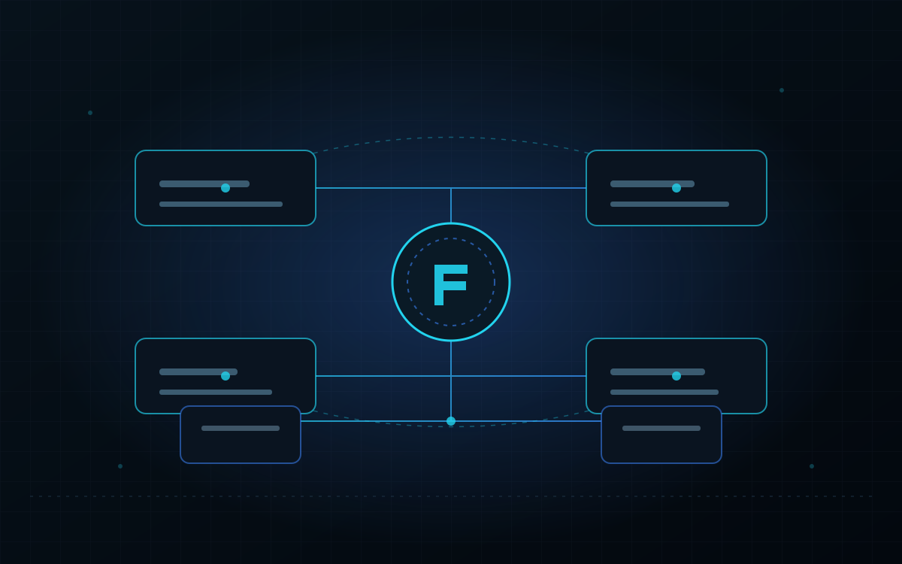

# Relay API Platform

A versioned REST API built by **SYFERON** with Express and SQLite, paired with a React developer console. It demonstrates the ideas behind a backend that stays understandable as the number of consumers grows: a real data contract, safe retries, consistent errors and tests that run in CI.



Relay is the backend half of a full-stack pair. [Atlas Analytics](https://github.com/OlaniTech/atlas-analytics) consumes `/v1/analytics/dashboard` when `VITE_API_BASE_URL` points at this server.

## Run locally

### API server

```cmd
set "PATH=C:\Program Files\nodejs;%PATH%"
cd projects\relay-api-platform
npm install
npm run server
```

The API listens on `http://localhost:4000`. On first run it creates `data/relay.sqlite` and seeds a small event dataset. Check it with:

```cmd
curl http://localhost:4000/v1/health
```

### Web console (optional)

```cmd
npm run dev
```

Open the URL Vite prints (default `http://localhost:5174`). The console is a UI for the API contract; the published GitHub Pages build is static and simulates responses so it works without a backend.

## Full stack with Atlas Analytics

Use two terminals: `npm run server` here, and `npm run dev` in `projects/atlas-analytics` with `VITE_API_BASE_URL=http://localhost:4000` set in that project's `.env`. See the Atlas README for the exact steps.

## Endpoints

| Method | Path | Auth | Description |
| --- | --- | --- | --- |
| GET | `/v1/health`, `/v2/health` | Public | Service health and uptime |
| GET | `/v1/openapi.json` | Public | OpenAPI 3.0 contract |
| GET | `/v1/events?limit=20&cursor=...` | Bearer | List events with cursor pagination |
| POST | `/v1/events` | Bearer | Create an event; honours `Idempotency-Key` |
| GET | `/v1/events/:id` | Bearer | Retrieve one event |
| DELETE | `/v1/events/:id` | Bearer | Delete an event |
| GET | `/v1/analytics/dashboard` | Bearer | Aggregated metrics consumed by Atlas |

All `/v1` routes also work under `/v2`. Responses include `request_id` and `api_version`. Errors use one shape: `{ "error": { "code": "...", "message": "..." } }`.

Example request:

```cmd
curl -X POST http://localhost:4000/v1/events -H "Authorization: Bearer rly_live_demo" -H "Content-Type: application/json" -H "Idempotency-Key: order-1042" -d "{\"type\":\"event.created\",\"data\":{\"order\":1042}}"
```

Repeating that request with the same `Idempotency-Key` replays the original event instead of creating a duplicate.

## Configuration

| Variable | Default | Purpose |
| --- | --- | --- |
| `PORT` | `4000` | HTTP port |
| `DB_FILE` | `data/relay.sqlite` | SQLite file location (`:memory:` also works) |
| `RELAY_API_KEY` | `rly_live_demo` | Bearer token required by protected routes |

These are local demo defaults, not production secrets. Do not deploy them publicly.

## Tests and CI

```cmd
npm test
npm run build
```

Seven Node tests use an in-memory SQLite database and a real HTTP server to cover health, auth, creation, idempotent replay, validation errors, pagination/CRUD and the analytics aggregate. The GitHub Actions workflow runs `npm test` before building and deploying the static console.

## Stack

Node.js 22+ · Express 5 · `node:sqlite` (no native driver install) · React 19 · TypeScript · Vite 8 · Node test runner.

## Part of the SYFERON portfolio

One of four published projects: Atlas Analytics, Relay API Platform, Sentinel Recon Toolkit and Signal Threat Intelligence. All demos carry the SYFERON watermark. These are portfolio demos, not production systems.

## License

MIT — see [LICENSE](./LICENSE).
